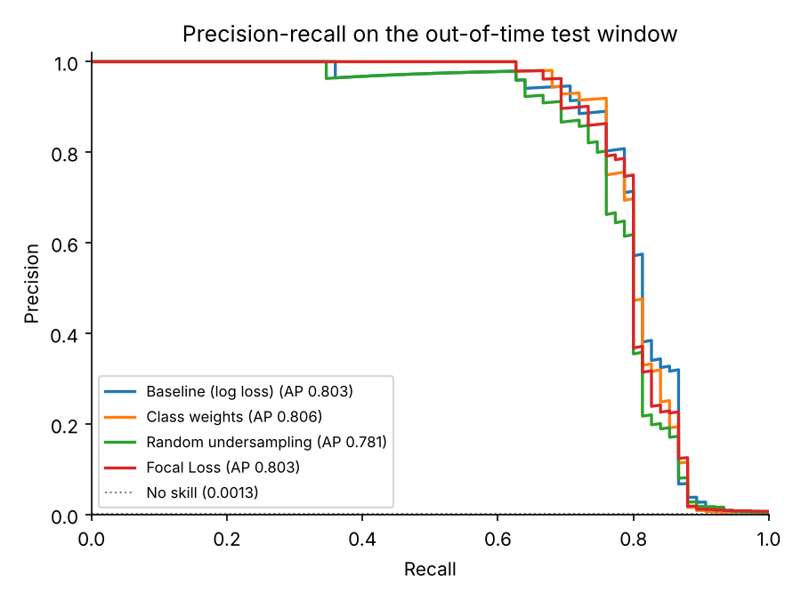
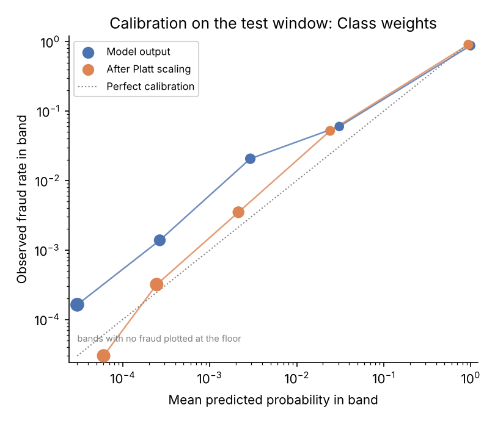
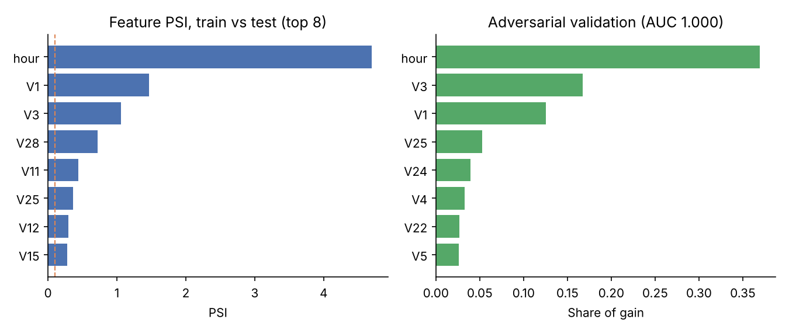

# Model Validation Report: Card Fraud Detection Under Class Imbalance

**Overall rating: Amber** (generated by `run_validation.py`; every number below comes from that run)

## Key findings
- All four approaches land within 0.025 PR-AUC of each other on the test window, and every one sits inside the selected model's 95% interval, so none is clearly better.
- Focal Loss reached a test PR-AUC of 0.803 against 0.803 for the plain baseline. The difference is within sampling noise, so on this data it does not justify the extra complexity of a custom objective.
- Performance held out of time: test PR-AUC 0.806 vs validation 0.792.
- The input features drift strongly between windows (adversarial AUC 1.00), yet the model score moves much less (PSI 0.12). Drift is the main reason to monitor this model rather than a reason to reject it.
- After Platt scaling, predicted fraud rate is 0.99 times the observed rate on the test window.

## 1. Purpose and scope
The model scores card transactions for the probability of fraud so that a fraud team can review the highest-risk ones.
Fraud makes up about 0.17% of transactions, so a model can look accurate while missing most fraud.
This study compares four ways of handling that imbalance with the same LightGBM learner and validates the selected model
the way an independent model risk function would: discrimination, operating performance, calibration, stability, drift and segments.

## 2. Data and sample design
Public dataset of 284,807 European card transactions over two days (ULB Machine Learning Group, via Kaggle).
Features V1 to V28 are PCA components supplied by the data owner, plus amount and hour of day.
The raw `Time` field is excluded as a feature because it encodes position in the sample, which would not generalise.

The split is chronological, so the test window is genuinely out of time:

| window | rows | frauds | fraud_rate | hours |
|---|---|---|---|---|
| train | 170884 | 360 | 0.211% | 0.0 to 33.4 |
| valid | 56961 | 57 | 0.100% | 33.4 to 40.3 |
| test | 56962 | 75 | 0.132% | 40.3 to 48.0 |

Model selection, early stopping, threshold choice and calibration use only the validation window. The test window is used once, for the results below.

## 3. Candidate approaches
| Approach | What it does |
|---|---|
| Baseline | Standard log loss, no imbalance handling |
| Class weights | Fraud cases weighted by the negative to positive ratio |
| Random undersampling | Training on all frauds plus 10 legitimate transactions per fraud |
| Focal Loss | Custom LightGBM objective that down-weights easy examples (alpha and gamma tuned on validation) |

All four share the same tree settings and early stopping on validation PR-AUC.

Focal Loss tuning grid (validation PR-AUC):

| alpha | gamma | valid_pr_auc | trees |
|---|---|---|---|
| 0.25 | 1.0 | 0.787 | 138.0 |
| 0.25 | 2.0 | 0.782 | 99.0 |
| 0.5 | 1.0 | 0.777 | 1761.0 |
| 0.5 | 2.0 | 0.789 | 99.0 |
| 0.75 | 1.0 | 0.783 | 569.0 |
| 0.75 | 2.0 | 0.786 | 98.0 |

## 4. Performance on the out-of-time test window
The operating threshold is set on the validation window at a 0.1% false-positive rate (one false alert per 1,000 legitimate transactions) and then applied unchanged to the test window. The test window has 75 frauds, so the intervals are wide; differences inside them should not be over-read.

| Model | Valid PR-AUC | Test PR-AUC (95% CI) | Test ROC-AUC | Recall at 0.1% FPR | Precision | Alerts | Frauds caught |
|---|---|---|---|---|---|---|---|
| Baseline (log loss) | 0.785 | 0.803 (0.715 to 0.882) | 0.9854 | 81.3% | 53.0% | 115 | 61 |
| **Class weights** | 0.792 | 0.806 (0.718 to 0.883) | 0.9758 | 80.0% | 50.4% | 119 | 60 |
| Random undersampling | 0.780 | 0.781 (0.692 to 0.860) | 0.9840 | 80.0% | 50.4% | 119 | 60 |
| Focal Loss | 0.789 | 0.803 (0.717 to 0.879) | 0.9849 | 80.0% | 49.2% | 122 | 60 |

Selected model (highest validation PR-AUC): **Class weights** (scale_pos_weight = 473.7)

## 5. Calibration
Imbalance treatments change the scale of the scores. Class weights, undersampling and Focal Loss all distort probabilities, which matters whenever scores feed expected-loss estimates or alert budgets. Platt scaling fitted on the validation window corrects this.

| probabilities | brier | ece | pred_over_obs |
|---|---|---|---|
| Model output | 0.000455 | 0.000194 | 0.94 |
| After Platt scaling (fitted on validation) | 0.000397 | 0.000137 | 0.99 |

`pred_over_obs` is the mean predicted probability divided by the observed fraud rate (1.00 is perfect).

## 6. Stability and drift (train window vs test window)
- PSI of the model score: **0.120**
- Adversarial validation AUC: **1.000** (0.5 means the two windows cannot be told apart)
- Features with the highest PSI: hour (4.698), V1 (1.463), V3 (1.062), V28 (0.716), V11 (0.442)
- Features that best separate the windows: hour (37%), V3 (17%), V1 (13%), V25 (5%), V24 (4%)

## 7. Segment analysis (test window, by transaction amount)
| amount_band | transactions | frauds | pr_auc | recall |
|---|---|---|---|---|
| < 10 | 21786 | 45 | 0.839 | 84.4% |
| 10 to 100 | 25081 | 15 | 0.801 | 73.3% |
| 100 to 500 | 8480 | 11 | 0.803 | 81.8% |
| 500 and above | 1615 | 4 | n/a | 50.0% |

Segments with fewer than five frauds show n/a for PR-AUC.

## 8. Rating
| criterion | measure | value | rating |
|---|---|---|---|
| Discrimination | Test PR-AUC, lower 95% bound | 0.718 | Green |
| Score stability | PSI of model score, train vs test | 0.120 | Amber |
| Feature drift | Adversarial validation AUC, train vs test (Red only if test PR-AUC also falls >10% below validation) | 1.000 | Amber |
| Calibration | Predicted / observed fraud rate on test, after Platt scaling | 0.989 | Green |

The thresholds are illustrative choices for this study and are set in `src/fraudval/pipeline.py`. The overall rating is the worst individual rating.

## 9. Limitations
- Two days of data: the test window shows short-term stability only, and seasonal or behavioural drift cannot be assessed.
- The PCA features are anonymised, so conceptual soundness of individual drivers cannot be reviewed and no fairness analysis by customer group is possible.
- The test window holds few frauds, so recall and precision estimates carry wide uncertainty.
- No transaction-level costs are available; the 0.1% false-positive operating point stands in for an alert budget.

_Runtime: 2.5 minutes. Bootstrap resamples: 500._
